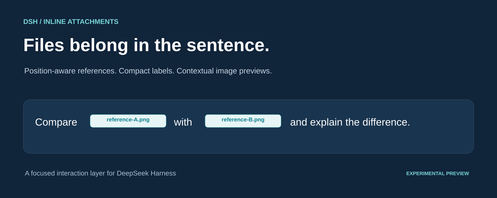
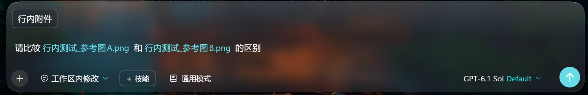
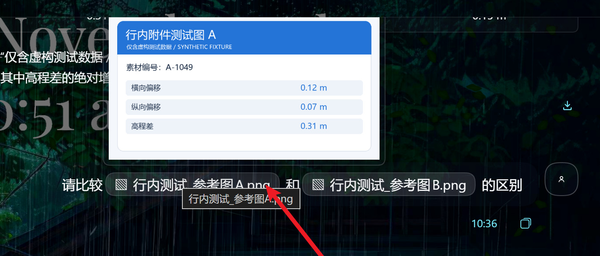
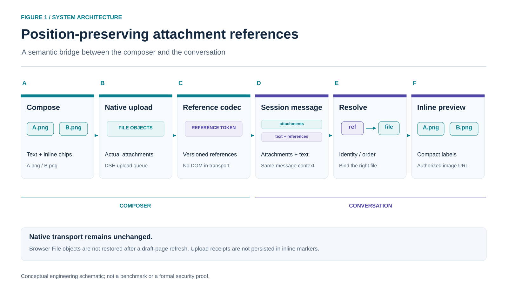
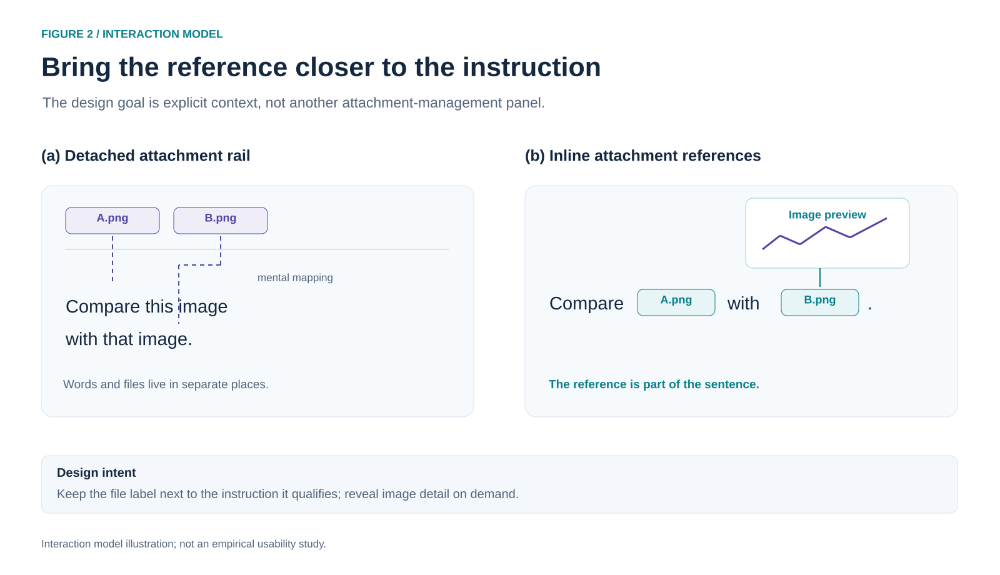

# DSH Inline Attachments

**Files belong in the sentence.**

Put files into the sentence you're writing in DSH. Each file appears as a short label; hover to see an image, and keep the same references in the sent message.

You don't have to open a file picker each time. Place the caret where the file belongs, then drag it from your desktop or file manager into the composer. Button selection and paste are available too. Insertion follows the current caret, not an automatically detected pointer drop position.

[中文](README.md) · [Releases](https://github.com/wuzeno/dsh-inline-attachments/releases) · [Architecture](docs/ARCHITECTURE.md) · [MIT](LICENSE)



## Why it matters

When several files sit above a message, “this image” and “that image” can be hard to match to the right attachments. Inline labels make the connection visible.

Write until you need a file, place the caret there, and drag it in. You can add another file later in the same sentence without referring to it as “the second attachment”. These are design choices, not measured usability or model-accuracy results.





These owner-supplied screenshots show synthetic test data. Any host token counts, speeds, or cache rates are not performance measurements of this plugin.

## Highlights

- Drag files into the composer and insert them at the current caret, including between words. No file-picker step is required. The labels use native reference chips, not a cosmetic DOM overlay.
- Compact labels and contextual image previews, with full names available on hover.
- Real attachments using DSH's existing upload and delivery pipeline.
- Same-message binding by durable identity or mixed attachment order.
- Guarded insertion and explicit handling of missing files instead of phantom attachments.
- Independent plugin: no edits to the DSH installation, no additional npm dependencies, and no extra API key required by the plugin itself. React and host capabilities remain runtime requirements.

## Install

In the DSH desktop plugin page, choose **Add plugin → Install third-party plugin**, then enter:

```text
https://github.com/wuzeno/dsh-inline-attachments
```

Enable the plugin and look for the inline-attachment button in the composer. You may also use the built npm archive from [Releases](https://github.com/wuzeno/dsh-inline-attachments/releases) or a local clone. The project is **not published to the npm registry**. Follow the host's refresh/restart instructions; the plugin never restarts DSH automatically.

Try two non-sensitive images: type an instruction, place the caret where the first file belongs, and drag that image into the composer. Continue typing, then drag in the second image at the next caret position.

## Technical illustrations





These editable engineering/HCI schematics are not empirical studies, benchmarks, or publication endorsements. [Media provenance](docs/media/README.md) explains the source and license of every figure.

## Experimental preview: scope and limits

The image flow has been confirmed through owner-provided Windows desktop screenshots: inline labels after sending and hover previews of the corresponding images. The release preparation also runs 28 local automated tests, primarily pure-codec and mocked React/slot tests—not full browser E2E tests.

- Sent-document click preview is **not connected**. Do not treat this as a general document viewer.
- Unsent browser File objects do **not** survive a page refresh. Reattach missing files.
- Chip cut/move, delete-then-undo, cross-session copying and cross-workspace draft transfer are **not supported**. A restored chip may lack its file.
- Drag/paste uses the current caret, not necessarily the pointer drop position. The controls are implemented, but validate them in your own environment.
- Draft text previews support files up to 2 MiB; other draft formats offer the original file for download.
- Complete refresh/history replay, other platforms, and plugin combinations need further manual testing. The manifest's version range is a declaration, not exhaustive compatibility evidence.
- Models, copy operations, and clients without the plugin may still see a versioned text marker. Filenames and document attachment IDs can appear in that metadata. No anonymity or zero-metadata guarantee is made.
- Removing the plugin restores native presentation but does not rewrite existing history markers.

See [Architecture](docs/ARCHITECTURE.md), [Changelog](CHANGELOG.md), and the Chinese [full documentation](README.md) for details.

## Build and test

Node.js 22.13+ is required. No npm dependency installation is needed for the core build and tests:

```bash
npm run check
npm pack
npm run verify:package
```

On Windows PowerShell, use `npm.cmd` if script policy blocks `npm.ps1`. The distribution verifier reads the actual archive and checks exports, licensing, source/bundle consistency, and ModuleLoader registration. Python + Pillow are optional authoring tools for the editable media, not plugin runtime dependencies.

## License

Code and original repository figures: [MIT](LICENSE). DSH, React and third-party screenshot elements retain their respective rights. This independent plugin is not an official DeepSeek product or endorsement. Please do not include credentials, authentication URLs, or private files in issues.
