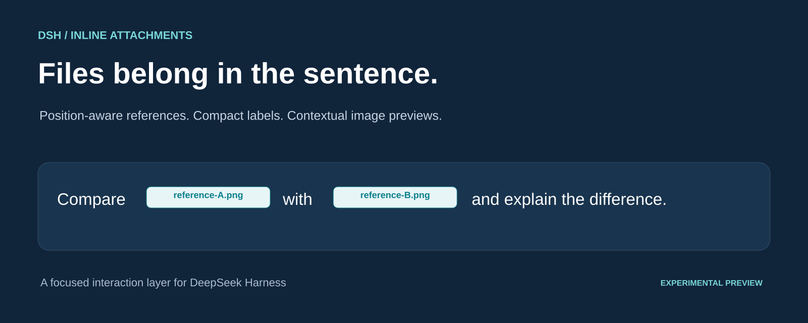
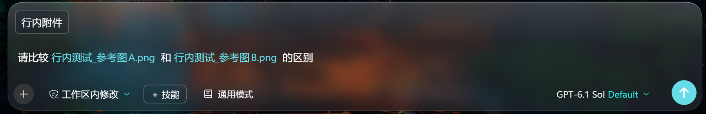
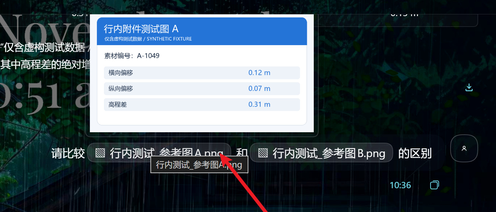
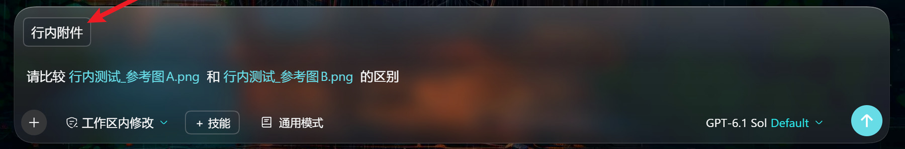
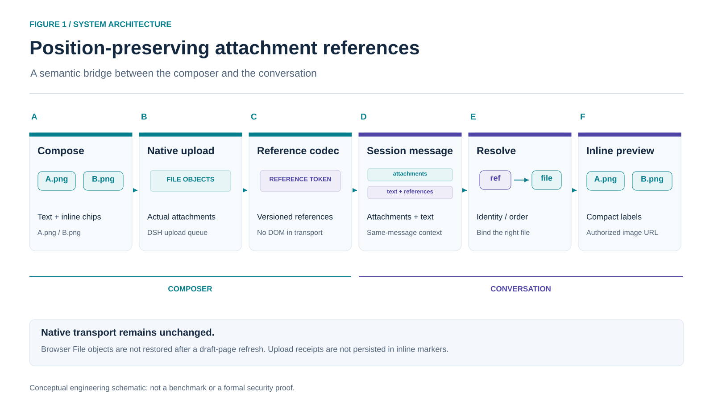
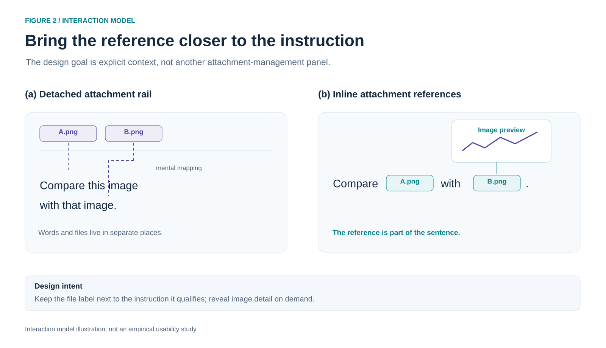

# DSH Inline Attachments · 行内附件

**让文件成为表达的一部分。**

在 DSH 写消息时，把文件插到正在说的那句话里。标签只显示文件名，鼠标移上去就能看图片；发出去后，文件和文字的位置关系也保留下来。

**不用每次都点上传按钮。** 先把光标放到想插入文件的位置，再从桌面或文件管理器把文件拖进输入区域，就能把附件插到句首、句中或句尾。按钮选择和粘贴也可以用。

[](https://github.com/wuzeno/dsh-inline-attachments/actions/workflows/ci.yml)
[](LICENSE)
[](#当前状态与边界)

[English](README.en.md) · [安装](#安装) · [交互原理](#交互与技术设计) · [开发说明](docs/ARCHITECTURE.md) · [版本记录](CHANGELOG.md)



## 一个值得打磨的交互细节

发消息时，经常要写“参考这张图”“按照这份文件修改”。如果文件全堆在输入框上方，放得多了，就容易分不清一句话说的是哪个附件。

用了行内附件，就可以这样写：

> 请比较 **[参考图 A]** 和 **[参考图 B]** 的区别。

这两个名称在实际界面中是文件标签，不需要手写。写到哪份素材，就把光标放在那里，再把文件拖进来。需要看图片时，把鼠标移到标签上就行。

写比较长的说明时，可以一边写，一边把素材放到对应的文字旁边，不用另开附件管理面板。回头看消息，也不用再猜“第二张图”究竟指的是哪个附件。

## 真实效果

### 输入时，文件跟着句子走



想把文件放在哪句话里，先把光标点到那里，再把文件拖进输入区域。也可以点“行内附件”按钮选文件，或直接粘贴。

注意：拖入和粘贴都按当前光标位置插入，不是按鼠标落点自动选位置；拖动已有标签重新排序也还不支持。

### 发送后，引用仍然清楚



上图是项目所有者提供的桌面实测截图：消息中的两个图片标签保持句中位置，悬停时显示对应测试图。图中均为虚构测试数据；宿主界面中出现的用量、速度、缓存率不是本插件的性能指标。

<details>
<summary>查看附件入口截图</summary>



静态截图展示入口位置；按钮、拖放与粘贴的接入方式见 [客户端实现](src/client.js)。

</details>

## 它把哪些细节做好了

- 文件可以直接拖进输入区域，插到光标所在的句子里。不必先点上传按钮，也不用在正文里留一长串路径；用的是 DSH 原生引用芯片。
- 图片平时只占一个小标签。悬停看细节，点击打开预览，不会把每张图都铺满消息区。
- 每个标签都对应真实附件。上传和投递沿用 DSH 原生流程，显示时按同一条消息中的附件身份或顺序匹配。
- 不用修改 DSH 安装目录或宿主源码，原来的消息操作和前置扩展链也保留。
- 如果插入位置已经变了，文件会保留，并提示你重新定位；如果文件丢了，不会把空标签当成有效附件发送。
- 不新增 npm 依赖，使用插件本身也不需要额外的 API 密钥。React 和运行时能力仍由宿主提供。

## 安装

> 当前版本是 **实验预览版**。建议先在非关键会话中试用，并阅读下方边界说明。

在 DSH 桌面版的 **插件 → 添加插件右侧菜单 → 安装第三方插件** 中，填写：

```text
https://github.com/wuzeno/dsh-inline-attachments
```

安装完成后点击 **立即启用**，回到聊天页查看“行内附件”按钮。也可以从 [Releases](https://github.com/wuzeno/dsh-inline-attachments/releases) 获取已构建的 npm 压缩包，或安装克隆后的本地仓库目录。

本项目**没有发布到 npm 注册表**；不要把仓库名称当作已经存在的 npm 安装包名。是否需要刷新或重启，以 DSH 插件管理器提示为准；插件不会主动重启应用。

### 首次体验

1. 输入“请比较”，保持光标在这句话后面，把第一张图片从文件夹拖进输入区域；也可以点“行内附件”选择。
2. 输入“和”，把第二张图片拖进来，再补上“的区别”。
3. 检查两个标签是否处在预期位置，发送后悬停查看对应图片。

不要用删除后撤销、跨会话剪切或刷新未发送草稿来测试正常恢复；这些属于当前未支持的流程。

## 交互与技术设计

### 图 1：保留位置语义的附件引用链路



插件负责把编辑器里的引用位置与原生附件连接起来。底层消息仍由附件部分和文本构成；插件没有把 DSH 的消息协议改造成富文本 DOM。文件的临时上传凭证不进入持久化的行内引用标记。

### 图 2：从分离附件栏到语境内引用



两图都是可编辑的工程/HCI 概念图，不是用户研究、性能基准或论文背书。提供 [SVG 源图与 PNG 预览](docs/media/README.md)，可用 [绘图脚本](scripts/render-release-art.py)重新生成。

### 工程实现

- [引用编码器](src/core.js)将位置引用编码为带版本的标记，并只在对应消息的附件集合中解析。
- [输入适配层](src/client.js)复用原生附件队列、引用芯片、上传状态和输入修订号。
- [历史渲染层](src/history.js)将引用还原为紧凑标签，并通过宿主授权 loader 请求图片。
- [插槽镜像层](src/slot-mirror.js)通过自有别名递归保留原生前置链的选择、注入、语言与存储上下文。

更多接口、生命周期及测试边界见 [架构说明](docs/ARCHITECTURE.md)。

## 当前状态与边界

Windows DSH 桌面版中的图片句内标签、发送后的对应关系和悬停预览，已经由项目所有者实测并提供截图。发布前本地自动测试为 **28 项通过**，主要覆盖编码器与模拟 React/slot 宿主，不能代替完整的浏览器端到端测试。尚未进行性能或模型准确率测量。

| 范围 | 当前状态 |
| --- | --- |
| 图片句中引用、发送后标签及悬停预览 | 已有桌面实测确认 |
| 按钮、输入区域拖放与文件粘贴 | 已实现；拖放链路仍建议按自己的环境验证 |
| 输入中的文本原文查看 | 已实现，小于等于 2 MiB；其他格式提供原文件下载 |
| 已发送文档的点击预览 | 尚未接通，不应按通用文档预览器使用 |
| 未发送附件的刷新恢复 | 不支持；浏览器 File 不随草稿引用持久化，需重新附加 |
| 芯片剪切移动、删除后撤销、跨会话复制、跨工作区携带 | 尚不支持，可能只恢复标签而丢失文件；请重新附加 |
| 完整刷新后的历史回放、其他平台与插件组合 | 待专项实机验收 |

还需要注意：

- 模型侧和未启用插件的客户端仍可能看到 `@[名称](dsh-attachment:v1:...)` 形式的文本标记。原生复制操作也可能包含它。文件名与文档 attachmentId 可进入这些元数据；本插件不提供匿名化或“零元数据”保证。
- 删除已观察到的标签会移除相应草稿附件，防止不再可见的文件被悄悄发送。Undo 只恢复标签时，应删掉悬空标签并重新选择文件。
- 桌面版已有的 `@路径` 文件引用由宿主管理，并不等同于上传附件。
- manifest 中的 DSH 版本范围是安装声明，不代表该范围内所有版本均完成兼容测试。
- 卸载插件会恢复原生呈现，但不会自动改写历史消息或删除其中的引用标记。

## 开发与验证

需要 Node.js 22.13 或更新版本。核心构建与测试无需安装 npm 依赖：

```bash
npm run check
npm pack
npm run verify:package
```

Windows PowerShell 若阻止 `npm.ps1`，请使用 `npm.cmd`。构建会合并四份源码生成 [client.js](client.js)，并检查语法与测试；分发校验会实际读取 tgz，检查入口、许可证、源码/产物一致性以及 ModuleLoader 注册。

可视化素材的再生成另外需要 Python 与 Pillow，不是插件运行时依赖：

```bash
python scripts/render-release-art.py
```

截图来自所有者主动提供的本机素材目录，仓库不包含该私人目录，也不依赖其绝对路径运行。

欢迎提交 [Issue](https://github.com/wuzeno/dsh-inline-attachments/issues) 或 PR，尤其是文档预览适配、可撤销附件生命周期以及跨平台真实交互测试。反馈时请提供 DSH 版本、操作步骤与不含敏感信息的截图，**不要上传认证链接、密钥或真实私密文件**。

## 许可与图像说明

代码及本仓库原创图示使用 [MIT License](LICENSE)。DSH、React 与截图中的第三方界面/壁纸等元素仍归各自权利人所有，不因本仓库的代码许可而被重新授权。详见 [图像来源说明](docs/media/README.md)。

本项目是独立插件，不表示获得 DeepSeek 官方认证或背书。
