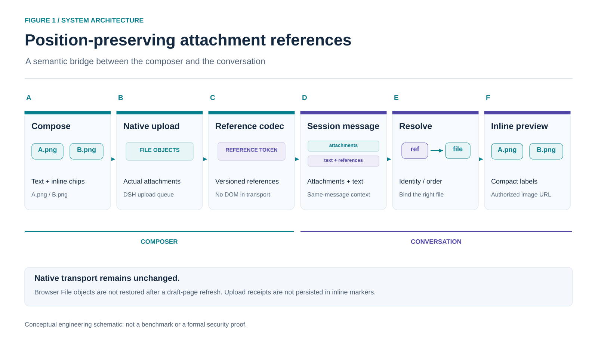

# Architecture and verification

## Design objective

Preserve the relationship between a reference's position in a sentence and a real attachment. This is a UI/serialization adapter over DSH, not a replacement transport, storage provider, model adapter, or document parsing service.

## Modules and ownership

| Module | Responsibility |
| --- | --- |
| [core.js](../src/core.js) | Versioned reference codec, validation, same-message identity/order resolution |
| [client.js source](../src/client.js) | Native input slot, guarded insertion, attachment snapshots, upload status and draft preview |
| [history.js](../src/history.js) | Compact inline references, authorized image loading, native text fallback and message-body adapter |
| [slot-mirror.js](../src/slot-mirror.js) | Preserve native child-slot authorization via private aliases and public slot registry APIs |
| [build script](../scripts/build.cjs) | Assemble the four sources into the committed [browser bundle](../client.js) |

The host owns admission, upload credentials, the attachment store and session access. React is provided by the host. The host-side plugin entry is deliberately empty; this project introduces no backend file-copy service or additional network endpoint.

## Reference lifecycle

1. The user selects, drops or pastes a file. DSH owns the actual attachment and upload state.
2. The plugin attempts to insert a source-owned native reference chip at a captured input span. Draft revision checks prevent stale asynchronous insertion from overwriting newer edits.
3. During submission, the reference codec uses the attachment snapshot. A missing file or an incomplete document upload rejects serialization.
4. The model-facing marker carries a version, name, mixed attachment index, kind, and an optional durable document attachment ID. It does not contain the upload receipt ID or the browser draft UUID.
5. History rendering resolves a marker only against the current message's attachments. Durable IDs do not fall back to an unrelated attachment. Duplicate objects prefer their intended occurrence.
6. Images are requested through DSH's session-authorized image loader. Native images are not replaced with guessed filesystem URLs.

The bottom-layer payload is still attachment parts and text. A non-plugin client may see the raw marker. This is not a claim that all providers understand a new multimodal rich-text protocol.

## Why the slot mirror exists

The native user node owns a pre-message chain. Reusing only its component loses the framework-provided child render functions, and can trigger an error boundary that retires the shadow entry. Steering nodes also have native injection behavior that must remain intact.

The mirror declares plugin-owned aliases, copies public entry metadata (`select`, `inject`, `locale`, `store`), translates child names at component boundaries, and recursively follows child registration changes. It does not redeclare existing native child slots or overwrite an existing Factory definition. Cleanup removes subscriptions and alias members before releasing their owners.

A short-name UserText rule is also registered as a fallback for native echoes and views that do not use the rich body adapter. Its noninteractive label does not pretend that a document preview bridge exists.

## Verification evidence

The tests in [test](../test) cover marker roundtrips, malformed inputs, shared mixed order, durable identity, duplicate attachment occurrences, missing drafts, unfinished uploads, chip deletion, failed-send restoration, the required selector-Hook contract, native priority competition, slot-child authorization, nested chain mirroring, steering injection, registration replacement, cleanup, and readable fallback labels.

Release preparation ran 28 tests locally. The [CI workflow](../.github/workflows/ci.yml) repeats build/test and package checks on Node.js 22 and 24. CI outcomes should be read from the actual workflow badge, not inferred from this document.

The [package verifier](../scripts/verify-package.cjs) opens the actual tgz without installing it and checks safe members, exports, the license, and byte-for-byte source/bundle consistency before evaluating its ModuleLoader registration in a VM.

The owner has also confirmed the picture flow in a Windows DSH desktop session; [screenshots](media/README.md) show inline sent-message labels and hover preview. This is narrower than an automated browser E2E suite. No benchmark, cognitive-load measurement or model-accuracy experiment has been performed.

## Known lifecycle boundaries

A saved reference is not a saved browser File. A refresh can restore a chip without its bytes. Deleting an observed chip releases its attachment; editor Undo can restore only the chip. Cut/move, cross-session and cross-workspace workflows therefore require a new attachment and are not advertised as supported.

The post-send document preview bridge is missing. Existing image loading must not be generalized into document-reading authorization. Screenshot review, end-to-end upload testing, and host version compatibility remain separate from the mocked unit tests.
